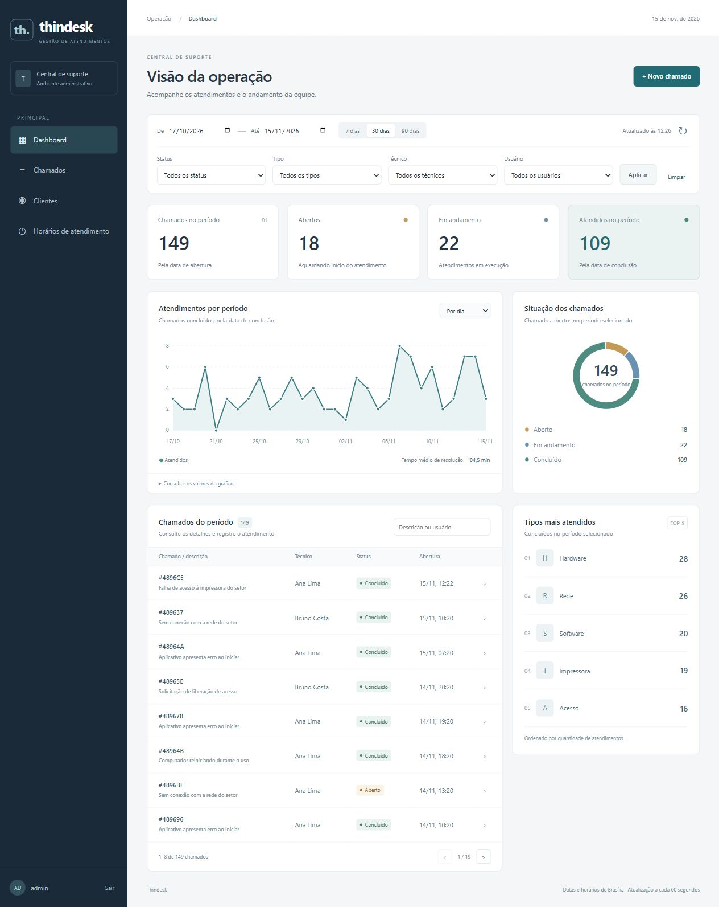

# Thindesk - documentação do projeto


---

# Thindesk - análise e projeto

## Escopo

O dashboard administrativo acompanha os chamados do Thindesk. A interface consome endpoints implementados no mesmo projeto Spring Boot e usa a coleção chamados do MongoDB. O sistema original foi mantido como base.

## Requisitos funcionais

| Código | Requisito | Implementação |
| --- | --- | --- |
| RF01 | Indicadores gerais de chamados técnicos | Total aberto no período, abertos, em andamento, atendidos e tempo médio. |
| RF02 | Chamados atendidos por período | Gráfico pela data de conclusão, agrupado por dia, semana ou mês, com tabela de valores. |
| RF03 | Situação dos chamados | Distribuição por status e situação individual na lista e no detalhe. |
| RF04 | Tipos de chamados mais atendidos | Ranking dos cinco tipos com maior quantidade de conclusões. |
| RF05 | Filtros | Período, status, tipo, técnico, usuário e busca por descrição ou usuário. |
| RF06 | Integração com a API | Consultas e gravações por HTTP, com dados persistidos no MongoDB. |
| RF07 | Atualização e tratamento de dados | Atualização manual e automática, carregamento, erro, nova tentativa e consulta vazia. |

Recursos complementares: cadastro, edição, início e conclusão do atendimento, considerações técnicas e histórico.

## Requisitos não funcionais

- Java 21 e Maven Wrapper para execução reproduzível.
- Login por sessão; endpoints autenticados e proteção CSRF nas escritas.
- Validação dos campos e parâmetros, limite de 100 registros por página e intervalo máximo de 366 dias.
- Interface responsiva, rótulos, navegação por teclado e valores dos gráficos disponíveis em tabela.
- Valores de data armazenados em UTC e apresentados em America/Sao_Paulo.
- Separação entre controllers, validações, serviços e acesso a dados.
- Alterações atômicas por documento com versão para impedir sobrescritas concorrentes.
- Dados de demonstração separados do banco padrão.

Não foi realizado teste de carga nem auditoria completa de acessibilidade. O projeto é destinado à atividade e à execução local.

## Modelo de dados

A coleção chamados mantém id, descricao, status, tipo, tecnico e usuario do sistema original.

| Campo acrescentado | Finalidade |
| --- | --- |
| dataAbertura | Instante de criação do chamado. |
| dataConclusao | Instante em que o atendimento é concluído. |
| atualizadoEm | Última atualização. |
| versao | Controle de concorrência. |
| consideracoes | Lista de texto, autor autenticado e data de cada consideração. |
| historico | Lista de status, descrição e data dos eventos. |

Considerações e histórico são documentos embutidos no chamado. A atualização do status ou a inclusão de consideração incrementa a versão no mesmo comando atômico do MongoDB. Há índices em status, dataAbertura e dataConclusao.

As coleções clientes e horariosAtendimento continuam no projeto.

## Regras

1. Novos chamados recebem ABERTO e a data do servidor.
2. O fluxo é ABERTO, EM_ANDAMENTO e CONCLUIDO. Não é permitido pular o atendimento nem reabrir um chamado concluído.
3. A conclusão registra dataConclusao. Uma edição de chamado já concluído não muda essa data.
4. A versão atual é obrigatória nas alterações. Uma versão antiga retorna HTTP 409.
5. Considerações podem ser acrescentadas depois da conclusão e sempre registram o usuário autenticado.
6. Total, abertos, em andamento, distribuição e lista usam a data de abertura.
7. Atendidos, série, ranking e tempo médio usam a data de conclusão. Portanto, atendidos pode ser maior que o total aberto no período.
8. O tempo médio usa somente chamados concluídos com abertura e conclusão conhecidas e duração não negativa.
9. Sem atendimentos, o tempo médio retorna null. Dias sem conclusões aparecem com zero.
10. As semanas começam na segunda-feira. O primeiro rótulo semanal pode anteceder o filtro, mas os valores respeitam o intervalo.
11. Registros antigos sem datas não entram nos indicadores por período. A listagem semData=true permite consultá-los.
12. A migração normaliza as grafias antigas de status e o campo Tipo. O status anterior é preservado em statusAnteriorMigracao. Nenhuma data histórica é criada.
13. Os filtros textuais são aplicados por igualdade. A busca por descrição e usuário escapa os caracteres de expressão regular.
14. A atualização automática é suspensa com aba oculta, diálogo aberto ou consulta em andamento.

## Decisões de implementação

Java, Spring Boot, Thymeleaf e MongoDB mantêm a arquitetura do sistema entregue pelo professor. Os serviços do dashboard calculam os indicadores no banco, sem valores fixos na interface.

O dashboard usa HTML, CSS e JavaScript com gráficos SVG. A autenticação existente foi mantida, a proteção CSRF foi habilitada e as respostas de erro da API foram padronizadas.

O POM usa Spring Boot 3.4.13, gerenciamento central de dependências e Java 21. Não foram acrescentados outro backend ou outro banco de dados.

## Referências

- Spring Boot: https://docs.spring.io/spring-boot/3.4/
- Spring Data MongoDB: https://docs.spring.io/spring-data/mongodb/reference/
- MongoDB: https://www.mongodb.com/docs/manual/

---

# API do Thindesk

Base: http://127.0.0.1:8080/api. As respostas são JSON. Os endpoints exigem sessão autenticada. Escritas exigem Content-Type: application/json e o token CSRF obtido na página, no cabeçalho X-CSRF-TOKEN. Datas são ISO 8601 em UTC.

## Filtros

| Parâmetro | Valores |
| --- | --- |
| inicio, fim | AAAA-MM-DD, inclusivos em São Paulo. Padrão: últimos 30 dias. Máximo: 366 dias. |
| status | ABERTO, EM_ANDAMENTO, CONCLUIDO. |
| tipo, tecnico, usuario | Texto exato; opções obtidas em /dashboard/filtros. |
| busca | Até 100 caracteres; pesquisa na descrição e no usuário. |
| agrupamento | dia, semana ou mes; padrão dia. |
| pagina | Apenas /chamados; inteiro positivo; padrão 1. |
| limite | Apenas /chamados; 1 a 100; padrão 8. |
| semData | Apenas /chamados; true consulta somente registros sem abertura. Padrão false. |

Parâmetros desconhecidos ou repetidos retornam 400. semData=true substitui o critério de data de abertura na lista. Os demais filtros continuam aplicados.

## Consultas

| Método e endpoint | Retorno |
| --- | --- |
| GET /dashboard | indicadores, serie, situacao, ranking, atualizadoEm, inicio e fim. |
| GET /dashboard/indicadores | total, abertos, emAndamento, atendidos, tempoMedioMinutos e semData. |
| GET /dashboard/serie | Lista de data e quantidade de conclusões, preenchida com zeros. |
| GET /dashboard/status | Lista de status e quantidade, pela abertura. |
| GET /dashboard/tipos | Até cinco objetos com tipo e quantidade de conclusões. |
| GET /dashboard/filtros | tipos, tecnicos, usuarios e status disponíveis. |
| GET /chamados | chamados, pagina, limite, total e paginas. |
| GET /chamados/{id} | Chamado com datas, versão, histórico e considerações. |

Exemplo de requisição:

```http
GET /api/dashboard?inicio=2026-11-01&fim=2026-11-15&tipo=Rede
```

Formato de resposta ilustrativo:

```json
{
  "indicadores":{"total":3,"abertos":1,"emAndamento":1,"atendidos":2,"tempoMedioMinutos":60.0,"semData":0},
  "serie":[{"data":"2026-11-01","quantidade":2}],
  "situacao":[{"status":"ABERTO","quantidade":1},{"status":"EM_ANDAMENTO","quantidade":1},{"status":"CONCLUIDO","quantidade":1}],
  "ranking":[{"tipo":"Rede","quantidade":2}],
  "atualizadoEm":"2026-11-15T15:00:00Z",
  "inicio":"2026-11-01",
  "fim":"2026-11-15"
}
```

A série real inclui todos os dias do intervalo. Os endpoints individuais retornam diretamente o objeto ou a lista indicada na tabela, sem envelope adicional.

```http
GET /api/chamados?inicio=2026-11-01&fim=2026-11-15&status=ABERTO&pagina=1&limite=8
GET /api/chamados?semData=true
GET /api/chamados/675b1fa1d64af05ea59ee7d3
```

Exemplo de listagem vazia:

```json
{"chamados":[],"pagina":1,"limite":8,"total":0,"paginas":0}
```

## POST /chamados

Campos obrigatórios: descricao (1 a 1.000 caracteres), tipo (1 a 80), tecnico (1 a 100) e usuario (1 a 100). Espaços isolados não são aceitos.

```json
{"descricao":"Sem acesso à rede do setor","tipo":"Rede","tecnico":"Ana Lima","usuario":"Mariana Alves"}
```

Retorna 201, cabeçalho Location e o chamado completo. O servidor define status ABERTO, dataAbertura, atualizadoEm, versao 0 e histórico inicial. Não aceita datas de abertura fornecidas pelo cliente.

## PUT /chamados/{id}

Atualiza os dados do chamado. Todos os campos abaixo são obrigatórios:

```json
{"descricao":"Falha na conexão do setor","status":"ABERTO","tipo":"Rede","tecnico":"Ana Lima","usuario":"Mariana Alves","versao":0}
```

Retorna 200 com o chamado completo e versão incrementada. A alteração de status segue o mesmo fluxo permitido pelo PATCH.

## PATCH /chamados/{id}/status

```json
{"status":"EM_ANDAMENTO","versao":0}
```

Retorna 200 com o chamado atualizado, histórico e nova versão. A próxima alteração deve usar a versão retornada. CONCLUIDO preenche dataConclusao.

## POST /chamados/{id}/consideracoes

```json
{"texto":"Cabo substituído e conexão validada com o usuário.","versao":1}
```

Texto obrigatório de 1 a 2.000 caracteres. Retorna 201 com o chamado completo. O autor é o usuário da sessão, não um campo enviado pelo cliente.

Formato dos campos acrescentados ao chamado:

```json
{
  "dataAbertura":"2026-11-15T12:00:00Z",
  "dataConclusao":null,
  "atualizadoEm":"2026-11-15T13:00:00Z",
  "versao":2,
  "consideracoes":[{"texto":"Cabo substituído.","autor":"admin","data":"2026-11-15T13:00:00Z"}],
  "historico":[{"status":"ABERTO","descricao":"Chamado registrado.","data":"2026-11-15T12:00:00Z"}]
}
```

## Erros

```json
{"codigo":"VERSAO_DESATUALIZADA","mensagem":"O chamado foi alterado. Atualize os detalhes antes de salvar."}
```

| HTTP | Código / situação |
| --- | --- |
| 400 | DADOS_INVALIDOS: campos, JSON ou filtros inválidos. |
| 401 | NAO_AUTENTICADO: consulta sem sessão. |
| 403 | ACESSO_NEGADO: token CSRF ou sessão inválidos na escrita. |
| 404 | NAO_ENCONTRADO: chamado inexistente. |
| 405 | METODO_INVALIDO: método não permitido. |
| 409 | TRANSICAO_INVALIDA ou VERSAO_DESATUALIZADA. |
| 503 | BANCO_INDISPONIVEL: falha no acesso ao MongoDB. |

Consultas filtradas podem retornar 400; detalhes podem retornar 404; gravações podem retornar 400, 403 e 409, além de 404 quando há identificador. Todas as consultas dependem do banco e da autenticação.

O contrato de GET /chamados mudou da lista simples original para paginação. A entidade original permanece na mesma coleção.

---

# Testes do Thindesk

Execução em 15/11/2026, com Java 21.0.13, Spring Boot 3.4.13 e MongoDB 8.0.28.

| Suíte | Testes | Falhas | Erros | Ignorados |
| --- | --- | --- | --- | --- |
| DashboardIntegrationTest | 15 | 0 | 0 | 0 |
| FiltroChamadoTest | 4 | 0 | 0 | 0 |
| Total | 19 | 0 | 0 | 0 |

Os relatórios originais estão em evidencias/com.pfc.thindesk.DashboardIntegrationTest.txt e evidencias/com.pfc.thindesk.FiltroChamadoTest.txt.

## Integração

Os testes usam o MongoDB real e bancos temporários com prefixo thindesk_test_ e identificador aleatório. Cada teste começa com seus próprios registros. O banco temporário é removido ao final; o banco de demonstração não é alterado pela suíte.

Foram verificados: autenticação, CSRF, indicadores, datas de abertura e conclusão, ranking, filtros combinados, registros sem data, períodos zerados, parâmetros inválidos, cadastro e validação, controle de versão, fluxo dos status, considerações com autor autenticado, pedido de chamado inexistente e renderização da página.

O cenário de datas confirma que um chamado aberto antes do período e concluído dentro dele entra na quantidade de atendimentos. O cenário de registros antigos confirma que a data permanece ausente.

## Interface

Foi verificado no navegador o login, o carregamento dos indicadores, o cadastro de um chamado, o início do atendimento, o registro de uma consideração e a conclusão. O chamado permaneceu no banco após reiniciar a aplicação.

A verificação identificou uma falha na segunda atualização da tabela, causada pela substituição de um elemento usado na contagem. A referência foi corrigida e a atualização manual foi repetida com a lista carregada e sem aviso de erro.



Não foi realizado teste de carga, auditoria completa de acessibilidade ou teste em múltiplos navegadores. O workflow de CI está configurado, mas sua execução remota depende da publicação.

## Reprodução

Inicie o MongoDB e configure TEST_MONGO_URI, sem o nome do banco:

```powershell
$env:TEST_MONGO_URI = "mongodb://127.0.0.1:27028"
.\mvnw.cmd test
```

Sem a variável, os 15 testes de integração ficam ignorados e apenas os quatro testes unitários são executados.

---

# Demonstração - até 3 minutos

| Tempo | Demonstração |
| --- | --- |
| 0:00-0:20 | Apresentar o Thindesk e entrar no sistema. |
| 0:20-0:55 | Mostrar indicadores, gráfico de conclusões, distribuição e ranking. Alterar período e tipo. |
| 0:55-1:40 | Cadastrar chamado, iniciar atendimento, registrar consideração e concluir. Mostrar histórico. |
| 1:40-2:15 | Mostrar endpoints, campos de data e integração com o MongoDB. |
| 2:15-2:45 | Mostrar os testes e justificar Spring Boot, MongoDB e controle de versão. |
| 2:45-3:00 | Mostrar documentação e branches no repositório. |

Explicar que atendidos são contados pela data de conclusão, enquanto total e distribuição usam abertura. Mostrar que os registros antigos sem datas continuam consultáveis. Usar somente dados de demonstração na gravação.
