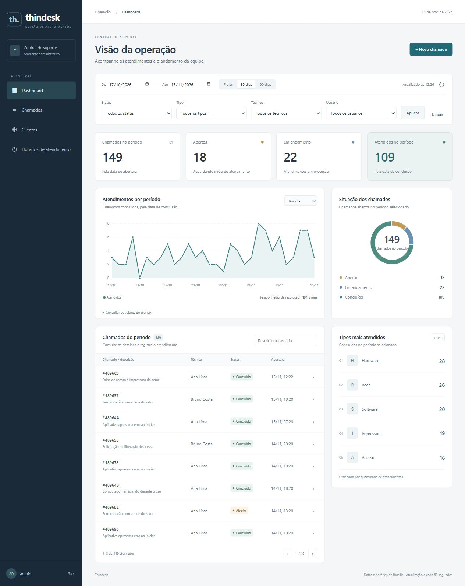
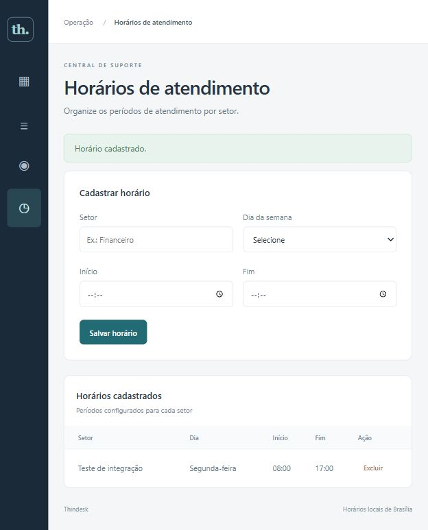

# Testes do Thindesk

## Ambiente e resultados

Execução em 15/11/2026, com Java 21.0.13, Spring Boot 3.4.13 e MongoDB 8.0.28.

| Suíte | Testes | Falhas | Erros | Ignorados |
| --- | --- | --- | --- | --- |
| DashboardIntegrationTest | 20 | 0 | 0 | 0 |
| FiltroChamadoTest | 4 | 0 | 0 | 0 |
| Total | 24 | 0 | 0 | 0 |

Relatórios de execução:

- [Testes de integração](evidencias/com.pfc.thindesk.DashboardIntegrationTest.txt)
- [Testes unitários](evidencias/com.pfc.thindesk.FiltroChamadoTest.txt)

## Cobertura

| Área | Verificações |
| --- | --- |
| Autenticação | Acesso à API sem sessão retorna 401. |
| CSRF | Escritas sem token válido retornam 403. |
| Indicadores | Contagem por abertura, atendimentos por conclusão e cálculo do tempo médio. |
| Série temporal | Conclusões no intervalo e preenchimento dos dias sem atendimentos. |
| Ranking | Quantidade por tipo, considerando apenas chamados concluídos. |
| Filtros | Combinação de status, tipo e técnico; rejeição de parâmetros inválidos ou repetidos. |
| Registros antigos | Consulta de chamados sem data, preservando a ausência do valor histórico. |
| Cadastro | Persistência dos campos, datas e histórico; rejeição de dados inválidos. |
| Andamento | Transições permitidas e conflito de versões. |
| Considerações | Persistência do texto e identificação do autor pela sessão. |
| Recursos inexistentes | Consulta de chamado inexistente retorna 404. |
| Navegação | Renderização de Dashboard, Chamados, Clientes e Horários. |
| Horários | Cadastro, listagem, validação do intervalo e exclusão por POST protegido. |

Os testes de integração utilizam bancos temporários com prefixo thindesk_test_ e identificador aleatório. Os dados são reiniciados entre cenários e o banco temporário é removido ao final. A suíte não modifica o banco de demonstração.

## Verificações da interface

Foram verificados no navegador: login, carregamento dos indicadores, cadastro de chamado, início do atendimento, registro de consideração, conclusão, atualização da tabela e consulta após reinício da aplicação.

Também foram verificados a navegação para Clientes e Horários e o cadastro, a listagem e a exclusão de um horário de teste.





## Reprodução

Com o MongoDB disponível, configure TEST_MONGO_URI sem o nome do banco e execute:

```powershell
$env:TEST_MONGO_URI = "mongodb://127.0.0.1:27028"
.\mvnw.cmd test
```

Sem essa variável, os 20 testes de integração ficam ignorados e apenas os quatro testes unitários são executados.

## Limites da verificação

Os resultados correspondem à execução local. Não incluem teste de carga, auditoria completa de acessibilidade ou verificação em múltiplos navegadores.
